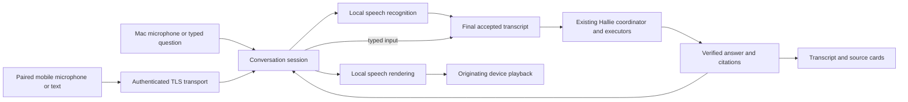

# Hallie Mae — full audio conversational mode

Status: parked — 2026-11-11. Design and implementation brief requested by Rick on 2026-11-08; implementation has not started. Rick 11/11: "we will come back to that eventually."

## 1. Recommendation and intended experience

**Start with a microphone on the M5 Ultra, then bring the same conversation service to an iPhone browser on the home network.** Keep the existing typed chat and spoken replies. Add a **Talk with Hallie** mode: start a conversation, speak naturally, hear a sourced answer, ask a follow-up, and interrupt when necessary. The Mac remains the librarian's home: its existing catalog, family tree, Hallie reasoning and voice serve every client.

Build this in three usable increments: Mac push-to-talk, private mobile push-to-talk, then hands-free conversation on both. Push-to-talk is an intermediate deliverable and a permanent fallback; it is not completion of this design. Do not begin with a new general-purpose speech-to-speech model, another family-knowledge store, or a standalone Hallie server rewrite.

If Rick prefers the iPhone first, do the shared core and mobile transport spike first, then deliver the phone push-to-talk slice before the Mac microphone UI. The shared core, privacy gate and review requirements stay the same. The Mac-first order is recommended because it separates recognition and conversation problems from certificate, network and browser problems.

**Initial scope:** Rick using his own Mac and paired mobile devices, on the home network, with VideoScan running and the Mac awake. A paired device receives Rick's authorized access; it is not a guest/family publication feature. Other mobile browsers should use the same protocol, with capabilities tested explicitly. Public family access, access while VideoScan is quit, wake-word listening, lock-screen/background calling, and a native iOS app are later extensions, not prerequisites.

The librarian experience should be concise and grounded. Hallie answers the question first, offers one useful follow-up when appropriate, asks which person if a name is ambiguous, and says when the record does not establish something. A warm voice must not make uncertain family history sound certain.

## 2. Existing implementation to extend

Inspected at `5b63268c96bfce1990a9cf1514d36086d5a3f64a`. These are source observations, not results of a live phone or microphone test. Claude must check the current implementation before editing; older parked-status and whole-answer voice descriptions in [hallie.md](hallie.md) do not establish today's behavior.

Paths below are relative to `VideoScan/VideoScan/` unless stated otherwise.

| Existing seam | What the code already provides; consequence for this work |
|---|---|
| `Hallie/ArchivistChatWindow.swift`, `Hallie/HallieAppTurnCoordinator.swift` | Desktop turns and the shared coordinator. Feed accepted speech transcripts through the same semantic path as text; do not build a second interpreter or genealogy engine. |
| `Hallie/HallieResponseCommit.swift` | Desktop response application checks active request identity/cancellation before speech, memory and UI effects. Preserve this boundary; apply equivalent ownership checks to mobile events. |
| `Hallie/Web/HallieWebAccess.swift`, `HallieWebServer.swift`, `HallieWebBridge.swift` | Existing LAN server and coordinator bridge with conversation state per supplied session ID. The server uses HTTP over TCP, one request per connection and a 64 KiB request-body limit. This is not an audio streaming transport. |
| `Hallie/Web/HallieWebPage.swift` | Existing chat/browse page, browser speech synthesis, and a `SpeechRecognition` / `webkitSpeechRecognition` microphone button. This is dictation, not a demonstrated private, interruptible conversation loop. |
| `Hallie/Web/HallieWebBridge.swift` | An empty configured passphrase currently permits requests; a supplied session ID and `who` come from the client. The current authorization also accepts a key in the query string. Do not carry these conventions into the new voice security boundary. |
| `Hallie/Voice/HallieSpeaker.swift`, `HallieNeuralSpeech.swift`, `HallieSpeechChunker.swift`, `HallieNeuralPlaybackLedger.swift` | Local Kokoro synthesis, chunked playback, cancellation and Apple voice fallback. Reuse voice selection, pronunciation and synthesis policy; separate audio rendering from the destination speaker. |
| `Hallie/HallieAppTurnCoordinator+Telling.swift` and coordinator `Dependencies` | Some conversation routes write testimony, photo captions, pronunciations, drill state or photo exclusions. Calling the existing coordinator is not automatically read-only. |
| `Hallie/LLM/HallieBrainResolver.swift`, `RemoteSerializer.swift` | Existing Local/Cloud selection and typed refusal of family media in cloud requests. Keep one brain-selection seam and its privacy canary. |
| `Media/AudioTranscriber.swift`, `WhisperWorkerTranscriber.swift` | Existing local file/batch transcription. A reusable fallback candidate, not evidence of a low-latency live recognizer. Do not route microphone turns through a catalog analysis job. |

This complements [Hallie's design](hallie.md), [the architecture contracts](../ARCHITECTURE.md#10-contracts) and [the existing decisions](../DECISIONS.md). It does not reopen the deterministic-facts rule, the Local/Cloud choice, or the separate Public-view proposal. No catalog schema change is expected.

## 3. Product behavior

Keep the text field available throughout. Add a prominent **Talk with Hallie** control, microphone/mute control, **Stop speaking**, **End conversation**, and an editable transcript. Do not start capturing on application launch, page load or reconnection.

| Situation | Required behavior |
|---|---|
| Start | Explain where audio is processed, obtain the actual OS/browser microphone permission, and show Listening only after capture starts. Show the selected brain and output destination. |
| Push-to-talk | Tap to start and tap to send; provide Cancel. The control is usable without holding a finger down. Keyboard equivalents exist on the Mac. |
| Hands-free | One initial Start allows successive turns. Show Listening → Transcribing → Thinking → Speaking; return to Listening after playback finishes. Interim words are visibly provisional. |
| Follow-up | “When was she born?”, “Which record says that?”, and “Tell me more about the second person” use the current session's stable identities, clarification choices and evidence. A new session starts empty. |
| Interrupt | A button works from the first slice. In hands-free mode, detected user speech also stops Hallie's playback and accepts the new turn. Do not require the word “stop” to finish recognition before stopping audio. |
| Misheard name | Offer correction or the existing which-person choice. A speech confidence value is not proof of a person's identity. Support spelling a name and switching to typing. |
| Answer | Display the full verified answer and source cards. Speak a short verified answer first, with uncertainty and an intelligible source phrase; longer detail is available on request. Do not read file paths or citation IDs aloud. |
| Mic muted / end | Mute blocks new capture/transmission; End also cancels pending recognition, inference and playback and releases capture resources. UI status reflects actual resources, not the last requested state. |
| Phone hides/locks, call arrives, route changes, network drops | Stop or suspend capture/playback safely and show Paused/Disconnected. Returning requires an explicit Resume. Foreground browser operation is the supported initial contract. |
| Missing model, denied permission, unsupported browser | Give the specific reason and retain typed chat. Never silently substitute cloud recognition. |

Phone answers play on the phone by default, not out of the M5 Ultra's speakers. Desktop answers continue to use the desktop voice setting. Remote turns do not move Rick's desktop selection or execute desktop commands. During media playback, pause conversational listening until an explicit resume, so a family video cannot become a new user command.

No wake word or identity-by-voice is needed. Device pairing establishes authority; microphone recognition only produces a possible question. Show “Rick” as the initial authenticated speaker; changing a display name must not impersonate another owner.

## 4. Architecture and implementation choices



### 4.1 One conversation owner, bounded work

Introduce a feature-owned `HallieConversationSession` and a small observable store for the UI; names are proposed. Reuse `ConversationMemory`, coordinator responses, clarification handling and the response-commit rules. Where current clients duplicate necessary session orchestration, extract only the shared portion and characterize its behavior first. No new `extension VideoScanModel`, no wholesale Hallie refactor.

Give each session an authenticated principal, server-issued session ID, active turn ID and monotonically increasing generation. Keep conversation mutation serialized on the existing main-actor boundary initially. Capture callbacks enqueue bounded buffers; audio conversion, recognition and synthesis run off the UI actor using framework-supported isolation. Do not introduce a repository-wide threading-model change.

One semantic turn runs per session. Duplicate submissions are idempotent; after every suspension, generation/turn ownership is rechecked before publishing words, sources, memory, audio or actions. Cancellation must reach the underlying work where supported, with stale-result rejection even when a provider cannot stop immediately.

Track conversation state separately from input and playback substates: hands-free interruption requires input monitoring while output is Speaking. A single mutually exclusive Listening/Speaking flag cannot represent full-duplex operation. The UI derives one understandable status from those states.

On interruption, stop local playback immediately, invalidate queued audio and the superseded turn, then process the new utterance. Retain already accepted verified text in the transcript with an Interrupted indication; do not treat unheard audio as heard or a partial answer as a completed offer. Discard unaccepted speculative results. “Continue” can use the last accepted answer; it must not revive canceled generation work.

Bound all queues, histories, connections and session lifetimes. Initially allow one active audio conversation globally; a second device gets an explicit busy response rather than preempting the first. Typed sessions remain isolated. The shared neural worker needs scheduling by request owner: canceling a phone turn must not shut down unrelated desktop speech or content analysis.

### 4.2 Speech recognition and audio output

**Preferred recognizer:** Apple's on-device `SpeechAnalyzer` with `SpeechTranscriber`, behind a small `SpeechInput` abstraction. It supports live processing and manages local model assets; availability starts at macOS/iOS 26, so keep VideoScan's macOS 15 deployment floor and gate the implementation at runtime. Inspect the actual SDK/locale/device support and prepare assets before the session, without capturing audio. [Apple overview](https://developer.apple.com/videos/play/wwdc2025/277/), [API and availability](https://developer.apple.com/documentation/speech/speechanalyzer).

On older systems, use `SFSpeechRecognizer` only after `supportsOnDeviceRecognition` is true and with `requiresOnDeviceRecognition = true`; otherwise use a proven local fallback or keep typing available. The existing Whisper worker is a candidate to measure for bounded utterances, not a required additional engine. Do not download a new dependency/model without following PROCESS §6. [Apple's local-recognition requirement](https://developer.apple.com/documentation/speech/sfspeechrecognitionrequest/requiresondevicerecognition).

Use `AVAudioEngine` for Mac capture. Convert from the device's actual format to the recognizer's supported format; handle format/route changes and unsupported input. Request permission only when Rick starts. Add the appropriate usage descriptions and entitlements for the chosen API, and verify a normally signed build rather than relying on an Xcode permission grant.

For full duplex, investigate Apple's voice-processing I/O and keep rendered output available to its echo-control path. Merely enabling a flag while playback uses an unrelated engine does not prove echo cancellation. Test speakers, headphones and Bluetooth routes. [Apple voice-processing API](https://developer.apple.com/documentation/avfaudio/avaudioionode/setvoiceprocessingenabled%28_%3A%29).

Reuse local Kokoro and the pronunciation lexicon for the recognizable Hallie voice. Introduce a speech-rendering seam yielding ordered audio chunks that can go to desktop playback or the paired client. Preserve the existing Apple fallback; a mobile fallback must be demonstrably local or return text with an explicit voice-unavailable state. Do not assume browser voice selection proves on-device synthesis. Keep old desktop typed→spoken behavior intact.

No family answer reaches TTS until it has passed the existing verifier. Start with the complete verified response; chunking that accepted text is fine. Do not stream raw LLM tokens to audio. Later incremental phrasing requires an independently verified unit, including identity, dates, qualifications and citations, before that unit is audible. Short spoken answers must be derived from approved claims/templates, not an unchecked summarization call.

### 4.3 Mobile transport and certificate bootstrap

Extend the existing web client and bridge; serve the new client over **trusted HTTPS** and use a versioned **WSS** connection for control events and bounded audio frames. Use a maintained protocol implementation, investigating Network framework's `NWProtocolWebSocket` first; do not implement WebSocket framing in the existing small HTTP parser. If a new server/proxy dependency is necessary, present the concrete choice, license and setup for Rick's PROCESS §6 approval while independent Mac work continues. [Apple WebSocket protocol](https://developer.apple.com/documentation/network/nwprotocolwebsocket).

Before investing in mobile UI, prove HTTPS trust and capture on Rick's actual iPhone. A LAN `http://<Mac>.local:8765` address is not a secure microphone origin on the phone, and an HTTPS page cannot rely on insecure `ws://` audio. The browser's localhost exception refers to the phone itself. [W3C media-capture requirements](https://www.w3.org/TR/mediacapture-streams/), [WebKit secure-origin explanation](https://webkit.org/blog/7763/a-closer-look-into-webrtc/).

Prefer an already available trusted HTTPS hostname/certificate arrangement. Otherwise prepare a LAN-only certificate setup, including explicit local-CA enrollment on Rick's phone if that is the chosen route. Document hostname resolution, certificate renewal, key storage and how to remove trust. OS trust installation is a user step; do not pretend to automate it or recommend bypassing certificate warnings. An existing private VPN can be evaluated separately; neither a public tunnel nor router port forwarding is part of this brief.

The mobile page uses `getUserMedia` for capture and sends audio to the Mac; it must not use the existing browser `SpeechRecognition` path. Browser recognition is an independently operated recognizer, not this app's local speech adapter; WebKit describes its Siri-based implementation. [WebKit speech recognition](https://webkit.org/blog/11648/new-webkit-features-in-safari-14-1/).

Use an `AudioWorklet` for bounded PCM capture/playback if supported by the tested clients. Negotiate sample rate, channel count and sample representation explicitly; do not assume Safari delivers 16 kHz or a particular recording codec. Convert on the Mac to the recognizer format. If using encoded chunks instead, negotiate a format actually supported on both ends, retain decoder continuity across chunks, and test the real decoder. Do not mix codec approaches without evidence of a need.

Start audio playback/AudioContext from the user's Start gesture, handle a rejected play/resume attempt, and show a tap-to-resume control. Test both Safari and the added-to-home-screen page; neither is promised to work when locked or backgrounded. [WebKit user-gesture guidance](https://webkit.org/blog/6784/new-video-policies-for-ios/).

Define a small typed protocol before implementation:

| Direction | Messages and required semantics |
|---|---|
| Client → Mac | `start`, `audio`, `endUtterance`, `text`, `interrupt`, `mute`, `endSession`, `playbackProgress`. Every turn event carries session/turn/generation and a sequence number; audio also has format/sample timing. |
| Mac → client | `ready`, `transcriptPartial`, `transcriptFinal`, `thinking`, `answer`, `audio`, `turnComplete`, `cancelled`, `error`. `answer` contains verified text, citations and the actual responder label. |
| Shared | A protocol version, negotiated capabilities, explicit error codes, deadlines, monotonic sequencing and bounded frame sizes. Unknown versions/invalid formats fail closed. Binary media stays out of text/JSON model payloads. |

Proposed initial bounds: 64 KiB per audio frame, 60 seconds and 12 MiB per utterance, no more than two seconds of unsent audio, and capped session/history storage with idle expiry. Check bytes as they arrive, before allocation/decoding, and validate sample counts against the negotiated format. These are starting limits, to be measured in the spike. Overflow cancels with a clear retry message; it must not silently drop words or build a delayed playback backlog. Keep interrupt/control traffic responsive under audio load.

Playback completion is a client event, not the moment the Mac finishes synthesis. Reconnection authenticates again; discard incomplete audio and never silently replay a turn. Resume conversation context only through a server-validated session owned by that device/principal. Expired or lost context requires an explicit new conversation.

WebRTC becomes a later option if measured network behavior requires its media transport features. It is not needed to prove a single-user LAN conversation and does not replace authentication, grounding or privacy policy. A native iOS client becomes worthwhile if reliable background/lock-screen use or browser audio limitations become requirements; it should consume this same session protocol.

## 5. Authority, privacy and family-record safety

**The new audio mode is read-only for family records, on both Mac and phone.** It may keep ephemeral conversation context and operational session credentials, but it may not save testimony, change names/dates/tags, teach pronunciations, exclude photos, recompile/pull the tree, or modify media. This does not remove existing explicitly invoked desktop features.

Enforce this as a capability at coordinator/tool and effect boundaries, not with a prompt, a list of forbidden phrases, or hidden buttons. Review all `Dependencies` writers, immediate offers and response sinks. Inject explicit denying writers, not silent no-ops that let Hallie say “saved.” Voice follow-ups and clarification continuations carry the same capability. A mixed question/write request must not slip past the policy through another clause or an old pending offer. A future “remember this story” feature needs a separate design, preview/confirmation and Codex review of its writer.

Raw microphone audio is family media. Recognition and speech rendering remain on Rick's devices. Local is the default brain; if Rick deliberately selects the existing Cloud option, only policy-allowed text may pass through `HallieBrainResolver`/`RemoteSerializer`, with the existing Cloud attribution visible. Before capture, make clear that Cloud mode can send the transcript and allowed answer context; it cannot send microphone audio. Never automatically fail over from local processing to a cloud service. Browser ASR, browser TTS and telemetry are also egress surfaces, not exceptions to this rule.

Pairing/authentication must precede allocation of a working conversation or access to any family source. Use a short-lived, single-use pairing challenge displayed on the Mac and a revocable device session. Protect long-lived secrets with Keychain or the platform's appropriate secure store; for the browser prefer a Secure, HttpOnly, SameSite session cookie. Validate Origin/Host and CSRF where applicable, including the WebSocket handshake; enforce authority again on subsequent events and media/source fetches. Never put a reusable secret in a URL, transcript, localStorage or log. Rate-limit pairing failures and active connections.

Do not simply expose the legacy listener through a TLS proxy: its empty-passphrase acceptance, client-chosen sessions/identity, query-string keys and existing write routes must not provide a bypass. Either adapt its relevant routes to the same authenticated capabilities or isolate the new service so legacy endpoints cannot obtain/reuse its credentials, sessions or resources. Preserve legacy typed-client behavior through tested compatibility where possible; any required security migration gets explicit setup guidance, not a silent fallback to unauthenticated HTTP.

Do not send absolute local paths, raw tree/catalog dumps or unrestricted attachment tokens to clients. Source/media capabilities must be bound to the authorized session and resource and checked again when fetched, including after revocation and source changes. Keep the existing file-identity/symlink checks. Treat retrieved text and transcripts as data, never as instructions granting tools or authority. Render untrusted text safely in the browser.

Keep captured audio in bounded memory by default. Where existing recognition/synthesis requires temporary files, use the app's private scratch lifecycle and bounded retention; no recordings in the catalog, git, shared web directory or general logs. Respect the repository's file-removal rules. Do not add persistent chat history as part of this feature. Audit existing conversation logging before routing microphone transcripts through it; preserve established local policy and avoid duplicating transcripts in transport diagnostics. Log session/turn IDs, timings, states and failure categories through the existing sink; redact secrets and audio. Log-path/format changes require PROCESS §6 review.

## 6. Claude implementation brief

Read `CLAUDE.md`, `docs/ARCHITECTURE.md`, `docs/STATUS.md`, `docs/PROCESS.md`, this document, and the actual seams in §2. Work in an isolated worktree and DerivedData. Implement only this feature; keep unrelated Hallie debt out of the change. Use the safety-critical workflow for any touched writer/authority path. No schema change, new dependency, broad concurrency change or live-data mutation is implicitly approved by this document.

| Slice | Work | Exit evidence |
|---|---|---|
| 0 — establish the baseline | Characterize current typed→spoken behavior, coordinator effects and web sessions. Inventory permissions, current voice, model readiness and supported client versions. Prove local ASR and iPhone HTTPS/audio transport with synthetic input. Record the selected audio format, trust setup and measured latency. | Small implementation plan naming exact types/files and any necessary approval; no claim that a generic browser microphone sample proves Hallie. |
| 1 — Mac conversation foundation | Add read-only session capability, turn/cancellation ownership, local recognition and Mac push-to-talk. Route finalized speech through Hallie and play verified answers through the existing voice. Preserve typing and existing desktop workflows. | Real microphone question, sourced spoken answer, pronoun follow-up, typed correction, Stop, End and denied-permission recovery. New tests plus touched suites and sensors; first scoped Codex pass on authority/effects. |
| 2 — private mobile conversation | Add trusted TLS, pairing/revocation, versioned bounded audio transport and responsive web controls. Reuse the same local ASR, Hallie coordinator and voice renderer. Enforce session-bound resources and output routing. | Physical iPhone completes a multi-turn push-to-talk conversation, hears Hallie on the phone, and survives disconnect/reconnect safely. Unauthorized device gets no family data or processing. Second Codex pass covers network/session/privacy paths and shared changes since the first pass. |
| 3 — hands-free conversation | Add speech activity/end-of-turn detection, automatic re-listening, speaker echo handling, interruption and short verified spoken answers. Keep push-to-talk available. Measure/adjust endpointing and buffering without weakening grounding. | Mac and iPhone each pass the hands-free acceptance conversation and interruption tests below. Speaker mode must pass echo tests; a headphone-only or half-duplex result is labeled a partial delivery. Codex reviews the final changed cancellation/authority surfaces. |

Start endpointing around 600–900 ms of silence, with a manual Send control and a maximum utterance length. Treat these as tuning parameters, not speaker-independent truth. Preserve initial phonemes with a small bounded pre-roll while capture is explicitly active. Silence, music and Hallie's own speech must not invent user turns; incomplete speech should lead to “I didn't catch that” or an editable transcript.

Use Debug for iteration. Measure the real voice experience in Release, with build SHA, device/OS/browser, audio route, selected brain/voice and warm/cold state recorded. Do not change the brain just to make a latency number look better. Existing decisions record a local-model p50 around 10.6 seconds on an earlier E1 workload; a natural conversation may need latency work, not merely a microphone.

Performance objectives, to validate rather than promise:

- Stop/interrupt silences local playback within 250 ms of the button or accepted speech-start event, independent of a server round trip. Measure speech-detection delay separately.
- Warm recognition finalizes within 1.5 seconds after the endpoint decision at p95.
- From the end of the user's speech to first **verified answer audio**: target p50 ≤ 3 seconds, p95 ≤ 8 seconds on the M5 Ultra/LAN. A filler sound or “let me check” does not count. Report missed targets and the measured bottleneck honestly.
- Ten minutes of conversation leaves bounded queues and stable memory; long jobs do not starve interactive capture. A second audio client is refused cleanly under the initial one-active-session policy.

Measure capture/endpoint delay, final transcript, Hallie execution, verification, first synthesized chunk, network delivery and first playback separately. Use at least 30 representative turns for the latency report, including ambiguous names and follow-ups; keep real family recordings/results out of git. Missing locale assets and cold model starts get explicit preparation status.

Ship slices through PROCESS's ordinary checklist, tests, sensor lane and scoped review. Claude owns integration/merge under the repository rules; Codex never pushes or changes Rick's checkout. Ask Rick only for the specific dependency/schema/other escalation the rules actually require, after preparing the concrete choice. The usual visible-feature spot tests still apply. An interactive conversation is not an MFO media-analysis job; any separate long media/model-preparation job must follow the existing job/logging rules.

## 7. Test and acceptance plan

Test application-owned logic with fake clocks, audio sources, recognizers, model backends, writer spies and audio sinks. Use synthetic family fixtures and poisoned preferences/Keychain/filesystem roots. Hardware checks supplement deterministic tests; they do not replace them.

| Invariant | Required evidence |
|---|---|
| Typed behavior preserved | Characterize before refactoring; typed and finalized spoken versions of the same question produce equivalent verified claims, identities, clarification and source IDs. Existing typed→desktop-voice behavior remains. |
| No unverified speech | An invented name/date or rejected composition never reaches display/TTS; the deterministic verified fallback does. Spoken shortening retains uncertainty, negation and date precision. |
| No voice-triggered writes | Writer spies cover testimony, captions, pronunciations, drill saves, exclusions and immediate actions. Try ordinary speech, mixed clauses, pending offers, clarification, retry and reconnect. Assert no persistent family-record change and no false “saved” claim. |
| Exactly one accepted turn | Duplicate final ASR callbacks, repeated send, interrupted inference, late synthesis, old audio chunks and out-of-order completion cannot commit twice or replace the new turn. Cancel between every asynchronous boundary. |
| Session/identity isolation | Two devices and two tabs cannot read, cancel or resume each other's sessions or claim a different principal using `who`. “My father” uses the authenticated identity; stale choices after reset/source-generation changes are refused or clarified. |
| No family audio egress | Poisoned cloud transport fails if it sees microphone/audio bytes, encoded audio, frames or attachments. Local mode makes no cloud call; explicit Cloud receives only allowed text and attribution. Browser recognition is absent from the new capture path. |
| Network admission | Missing/expired/revoked credentials, wrong origin, forged session IDs, reused pairing challenge, cross-session media tokens and legacy-route bypass attempts all fail before data or expensive processing. Test actual listener/bridge wiring, not only an auth helper. |
| Bounded hostile input | Oversized/partial frames, invalid sample metadata, malformed control messages, slow senders, queue saturation and disconnect mid-utterance settle with bounded memory and no stray playback. |
| Lifecycle | Permission denial/revocation, unplugged mic, Bluetooth change, call interruption, background/lock, Mac sleep, app quit and restart release resources and never resume listening silently. |
| Echo and interruption | Speakers at normal volume, headphones and Bluetooth; long pause in a question; cough/music/silence; user speaks over Hallie. Her answer does not generate a new question; user's first word is retained. |
| Scale and isolation | 100k synthetic catalog rows with an explicit snapshot/search time budget and UI responsiveness measurement; many start/stop cycles; bounded sessions/history. Tests must never use real App Support, credentials or preferences by accident. |
| Media/source behavior | If changing source playback, run the existing mp4/h264, mov/prores, mkv/ffv1+pcm, mxf and avi/dv matrix and authorization checks. Otherwise record media-transcoding tests as not applicable, since transport of speech does not change archive codecs. |

Existing suites to select according to the actual diff, under `VideoScan/VideoScanTests/`: `HallieResponseCommitTests`, `HallieConversationMemoryTests`, `HallieAppTurnCoordinatorFollowUpTests`, `HallieGroundedCompositionTests`, `HallieTellingIntegrationTests`, `HallieSpeakerTests`, `HallieSpeechChunkerTests`, `HallieNeuralPlaybackLedgerTests`, `HallieWebTests`, `HallieWebPageTests`, `HallieWebServerStartupTests`, `HallieRemoteClientTests`, `HallieBrainChoiceTests`, and `HallieCloudBrainCanarySensorTests`. Run Whisper suites only if its adapter changes. Verify selectors exist and print executed counts; these names are not a claim that any tests ran for this document.

Add focused session, capability, capture-lifecycle and transport suites. Seat stable no-write/no-egress/stale-audio cases in `scripts/run_sensors.sh`; assign new tests to the gauntlet manifest under existing process. Each discovered bug needs a test seen RED before the fix and GREEN afterward. A pure feature test need not manufacture a historical bug. Run touched suites and the sensor lane on the exact integration tree. Run catalog tests only if catalog paths change, with the mandated writer/production-shape evidence if they do.

Heavy builds, complete replays and gauntlets run on the M4 in the established workflow. Rick's M5 Ultra microphone spot test is interactive; do not launch unattended UI, model loads or heavy tests there without a declared window. Report test counts, failing selectors and untested hardware cases; zero executed tests is failure.

**Rick's end-to-end acceptance conversation** (facts come from a fixture or records actually present; do not invent expected family answers):

1. Type a familiar question on the Mac and hear the existing voice.
2. Start Talk with Hallie; ask about a known ancestor, then “Where was she born?” and “Which record says that?” Hear grounded replies and see matching sources.
3. Ask about an ambiguous name, choose a person, correct a misheard word, then ask a pronoun follow-up. Verify the subject stays correct.
4. Interrupt a long reply by speaking, ask a different question and verify none of the old audio returns. Repeat with the Stop button.
5. Say “Remember that she was born in 1900.” Hallie explains this conversation cannot save changes; the family record is unchanged.
6. Pair the iPhone, repeat the conversation, and hear replies on the phone while the Mac remains quiet for that session. Repeat hands-free without pressing Send each turn.
7. Lock/unlock the phone, interrupt with a call or audio-route change, and disconnect/reconnect Wi-Fi. Nothing resumes listening or replays automatically; explicit Resume works.
8. Revoke the device on the Mac. Its next event and resource fetch fail, the session stops, and it must pair again. End the Mac session and verify microphone capture has stopped there too.

## 8. Codex reviewer brief

Codex is the independent adversarial reviewer and may author reproducing tests when requested. It does not implement this feature, redesign unrelated modules, push, delete files or modify Rick's checkout. Claude supplies a concrete review worktree and exact SHA range for each coherent batch. This document is the design brief, not a merge verdict on code that does not yet exist.

Prioritize these attacks by family-data/privacy/truth risk:

1. Reach a writer or irreversible/desktop effect from speech, an old offer, a hidden route or a resumed turn despite read-only capability; make Hallie claim a write succeeded when it did not.
2. Send family audio to a cloud recognizer/model/voice, including a browser fallback or text encoding, or leak it through logging/cache/error paths.
3. Cross the authenticated user/session boundary, reuse a revoked device/resource capability, or reach the same operation through an unprotected legacy route.
4. Speak/display an unsupported family fact or resolve a misrecognized name to the wrong person without clarification.
5. Let canceled/duplicate/out-of-order work mutate memory, play audio, accept an offer or stop another session.
6. Exhaust memory/workers through input, or retain capture after End, permission loss, disconnect or lifecycle interruption.

Read the named changed files and their direct callers only. Include the real coordinator/writer/effect call sites and transport ingress, not only the new helper. If establishing a finding requires expanding the scope, name why and what was read. Do not report a proposed implementation or an untested suspicion as a confirmed bug. Quote evidence limitations honestly.

Claude fills this template in `.scratch/briefs/` and invokes the existing review tool; no placeholder ranges or vague “review Hallie” requests:

```text
Workflow: Talk to Hallie on the Mac or a paired phone, hear sourced answers,
continue naturally and interrupt, without changing family records.
Range: <base SHA>..<head SHA>
Worktree: <absolute review worktree>
In scope: <exact changed files/functions and direct caller paths>
Invariants: <the applicable numbered attacks above, plus ARCHITECTURE §10>
Evidence already run: <exact commands, executed counts, red/green results,
sensor result, physical-device results, and explicitly untested cases>
Accepted limitations: <Rick's actual rulings; do not invent waivers>
Output:
Credits spent: <amount, or unavailable if not exposed> | Finding count: <N>
Verdict: merge | fix | block — <one sentence>
Then findings ranked by data-loss/privacy risk, each with file:line,
reproduction and a RED test where possible. For each scoped file without
a finding: "read, no findings." List any scope expansion and tests not run.
```

```sh
python3 tools/codex_review.py --title "Hallie audio: <slice>" --range <base>..<head> --brief <absolute-brief-path>
```

Run from the assigned worktree; do not run the placeholder command literally. Close each finding against the invariant with a regression, not just its example. Follow PROCESS §5's review loop and document any accepted residual issue. Authentication/privacy/no-write/grounding failures remain blockers for the new mode; do not label a working demo as a completed feature while those fail.

## 9. Delivery and later extensions

Claude's handoff states what Rick can do now, the build SHA and Debug/Release configuration, exact phone URL/pairing steps, supported tested devices, current latency numbers, tests/counts, Codex verdict/closures, and remaining limitations. Keep operational setup and rollback in this document while it is the active design. Disable Talk with Hallie and the new network listener to roll back operation; typed desktop Hallie must still work. No family-record migration should be needed.

Completion means both the Mac and a physical iPhone support a sourced, multi-turn, interruptible hands-free conversation and all applicable gates pass. A successful push-to-talk demo, simulator-only result, or a phone that speaks only through the Mac is an intermediate milestone.

Future work, only after this experience is measured: a native iOS client for background/audio-route integration; private remote access while away; separate authorized guest/public knowledge scopes; and explicitly confirmed oral-history capture through the existing CyberBrain writer. These are separate decisions, not implied authorization to widen this implementation.
