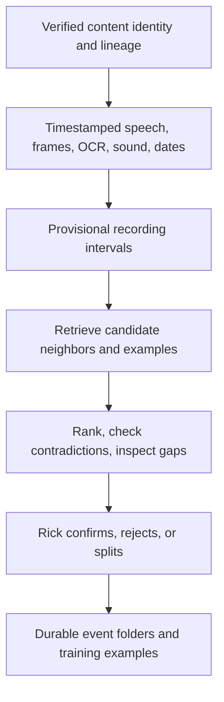

# Teaching VideoScan to recognize family occasions

Discussion paper for Rick and Claude · Codex Manager · 16 October 2026

**Recommendation:** continue the Events and virtual-folder direction. Add time-resolved evidence, retrieval by example, and learning from human association decisions. Start with frozen visual/video embeddings and a small learned relation model. Full visual-model fine-tuning is a later experiment with a specific acceptance test.

**Yes, there are useful technologies you have not exhausted.** The most relevant additional candidate is **Qwen3-VL-Embedding with its companion reranker**. **DINOv3** is another worthwhile experiment for matching visual details that captions omit. Neither establishes that two similar celebrations are the same occasion without other evidence. VideoScan's existing design already recognizes much of this distinction; implementing the deferred pieces is at least as important as adopting newer models.

This assessment reads the supplied three-page [training guide](family_media_ai_training_guide.pdf), the October 12–16 Events/Compare Media/folder designs, the September footage survey, and current source. Source baseline: `230781f016d2a6caa291013cad71693c8d9d90f4`, with existing unrelated working-tree edits. A read-only agent inspected the implementation. No VideoScan launch, family-media benchmark, model training, or app tests were performed. “Implemented” means present in this checkout; proposed benefits below are hypotheses to measure. Public technology sources were checked on October 16.

## 1. The important change in the problem

Identifying Donna across decades requires stable individual identity despite age, family resemblance, pose, and source degradation. Identifying an occasion can instead exploit clothes, a distinctive cake, room arrangement, decorations, spoken phrases, capture sequence, dates, and matching sound. Several of those clues need to remain stable for only an afternoon.

That makes the pivot promising, but it does not make event grouping automatic. The same relatives around the same dining table every Christmas is almost an adversarial dataset for generic semantic similarity. Your previous experience is a reason to measure this carefully, not evidence that all visual learning will fail.

VideoScan should keep four questions distinct:

| Question | Example | Appropriate evidence |
|---|---|---|
| What kind of activity? | Birthday, graduation, ordinary dinner | Visual semantics, speech, sound categories, text |
| Which particular occasion? | Timmy's birthday at this house in this year, including a second camera | Occasion-specific details, chronology, corroboration, Rick's decision |
| Which recording or portion? | Another transfer of one recording; an excerpt | Fixity, lineage, temporal audio/video correspondence |
| Which collection should show it? | Birthdays; a vacation; a family history selection | User organization; possibly several associations |

A successful birthday detector still does not distinguish this year's birthday from last year's. A sound match does not prove that two files contain the same pictures. A folder association does not establish that either file can be discarded.

## 2. What to take from the PDF—and what to reject

The guide is useful as a modular sketch: local processing, embeddings, reusable analysis, candidate clustering, and a language model used after retrieval. It is not a ready implementation plan, and despite its title, its script performs **no model training**. Computing embeddings and running DBSCAN changes neither the visual encoder nor a learned event decision function.

| PDF proposal | Assessment for VideoScan |
|---|---|
| Deduplicate before expensive analysis | Reuse analysis for verified identical content. Do not first remove compressed versions or clips: they may contain unique pictures, audio, titles, or provenance. VideoScan already has stronger preservation-specific machinery than this sketch. |
| Introduce Czkawka | Optional independent comparison tool, low priority here. It has duplicate/similar-media tools and protected reference paths, but similarity is not a proof of complete audiovisual coverage. Its own documentation distinguishes these tools. [Czkawka instructions](https://github.com/qarmin/czkawka/blob/master/instructions/Instruction.md) |
| Use InsightFace Buffalo_L to preserve skeletal identity through age | The guide supplies no evidence for this guarantee. Buffalo_L is a face-analysis package, not a demonstrated solution to your family/decade problem. The documented Python path uses ONNX Runtime providers; setting a PyTorch device to `mps` does not configure it. Current documentation includes Core ML support. [InsightFace documentation](https://pypi.org/project/insightface/), [ONNX Runtime Core ML provider](https://onnxruntime.ai/docs/execution-providers/CoreML-ExecutionProvider.html) |
| SigLIP 2 or EVA-CLIP frame embeddings | Useful direction. Start with one baseline, SigLIP 2, rather than simultaneously integrating several similar encoders. Test on actual tape footage. |
| DBSCAN/HDBSCAN creates the event folders | Useful exploratory grouping, insufficient authority for event instances. Similar holidays can chain together; one event with indoor/outdoor scenes can split. The script's `eps=0.35` is uncalibrated. DBSCAN's neighborhood radius does not bound a cluster's overall diameter, and scikit-learn documents worst-case quadratic memory. [DBSCAN documentation](https://scikit-learn.org/stable/modules/generated/sklearn.cluster.DBSCAN.html) |
| LanceDB plus zero-copy solves scale | A local vector index can be useful. It does not solve the inference problem. The sample immediately materializes a pandas table and a stacked NumPy matrix; zero-copy is not an end-to-end property of that code. LanceDB is an optional derived index, not a reason to replace the catalog. [LanceDB vector search](https://docs.lancedb.com/search/vector-search) |
| Name each group from one representative video | One sample cannot reveal a mixed group or tape. Compare diverse intervals and contradictory evidence. Names and dates in a title must come from grounded observations or Rick. |
| MLX-VLM is up to 28× faster | The PDF gives no reproducible benchmark. Do not use this multiplier for planning. MLX-VLM is relevant and supports local inference and fine-tuning; speed depends on the exact model, runtime, quantization, and input. [MLX-VLM](https://github.com/Blaizzy/mlx-vlm) |
| Execute the folder-sorting script | Do not use it on the archive. It physically moves files, has no VideoScan transaction/provenance integration or collision policy, invents exact dates from unspecified timestamps, and uses unstable cluster labels. It also splits a single cluster by each file's person/date. Your proposed virtual folders avoid those problems. |

The PDF's strongest idea is reusable representations. Its weakest assumption is that geometric clusters correspond to historical events.

## 3. What VideoScan already has, and where the gaps actually are

The [Events design](../design/events_design.md) is substantially more careful than the PDF: it distinguishes categories from instances, retains provenance, makes human decisions authoritative, anticipates ranges and mixed tapes, and separates association from removal. Keep that architecture.

The [v1 plan](../design/events_v1_plan_2026_10_14.md), [Compare Media design](../design/event_analyzer_compare_media_2026_10_15.md), and [October 16 folder design](../design/footage_folders_2026_10_16.md) describe different implementation stages. In particular, some Compare Media items marked “to build” now exist.

| Capability | Current source evidence | Consequence |
|---|---|---|
| Event input collection | [VideoScanModel+Events.swift:57](/Users/rickb/dev/VideoScan/VideoScan/VideoScan/Events/VideoScanModel+Events.swift:57) projects captions, transcript, resolved dates, people, and lineage | The planner does not receive raw OCR observations, fingerprints, embeddings, or sampling coverage. There is an integration gap before a model-quality gap. |
| Event categories | [EventCategoryRules.swift:158](/Users/rickb/dev/VideoScan/VideoScan/VideoScanCore/Sources/VideoScanCore/EventCategoryRules.swift:158) | Nine phrase-rule categories provide a transparent baseline; this is not a trained visual classifier. |
| Instance grouping | [EventsPlan.swift:771](/Users/rickb/dev/VideoScan/VideoScan/VideoScan/Events/EventsPlan.swift:771) | Category compatibility and folder/date adjacency propose groups. Four-day adjacency and a 14-day bound help, but do not establish a unique occasion. |
| Event addressability | [EventsPlan.swift:685](/Users/rickb/dev/VideoScan/VideoScan/VideoScan/Events/EventsPlan.swift:685) | Discovered members are whole-file `ContentRange`s without start/end. Several events on one transfer cannot yet be independently organized. |
| Speech | [whisper_worker.py:84](/Users/rickb/dev/VideoScan/scripts/whisper_worker.py:84) | The worker returns transcript text and discards the segment timing. Retaining those intervals is a high-value change. |
| Vision | [CaptionOrchestrator+DossierSteps.swift:96](/Users/rickb/dev/VideoScan/VideoScan/VideoScan/Media/CaptionOrchestrator+DossierSteps.swift:96) | Dossier samples evenly spaced still frames. That is useful captioning, but differs from inspecting a chronological video window. |
| Human decisions | [EventsDecisionStore.swift:34](/Users/rickb/dev/VideoScan/VideoScan/VideoScan/Events/EventsDecisionStore.swift:34), [decision kinds:88](/Users/rickb/dev/VideoScan/VideoScan/VideoScan/Events/EventsDecisionStore.swift:88) | Durable event IDs, membership decisions, rejections, and different-occasion decisions are a strong foundation for learning. They are not currently a training loop. |
| Identity and lineage | [VideoScanModel+Events.swift:73](/Users/rickb/dev/VideoScan/VideoScan/VideoScan/Events/VideoScanModel+Events.swift:73), [EventsPlan.swift:530](/Users/rickb/dev/VideoScan/VideoScan/VideoScan/Events/EventsPlan.swift:530) | Pair/full-digest identity and footage lineage remain distinct. Preserve this when adding learned similarity. |
| Compare Media | [CompareMediaView.swift:37](/Users/rickb/dev/VideoScan/VideoScan/VideoScan/MediaOps/CompareMediaView.swift:37), [RelatedEvidence:67](/Users/rickb/dev/VideoScan/VideoScan/VideoScan/Events/VideoScanModel+RelatedEvidence.swift:67) | The ladder, audio comparison, recommendations, and caller exist. This production path still passes `video: nil`; Core's visual-alignment input is not connected here. |
| Evidence review | [EventDetailSheet.swift:171](/Users/rickb/dev/VideoScan/VideoScan/VideoScan/Catalog/EventDetailSheet.swift:171) | Opening the file is available; jumping directly to the disputed evidence interval would make review much faster. |

The folder view itself appears to remain a design in the inspected Catalog/Events tree. It need not wait for a perfect analyzer: manually created, durable event folders provide immediate utility and useful supervised examples.

### One concrete decision-rule concern

[RelatedScore.swift:383](/Users/rickb/dev/VideoScan/VideoScan/VideoScanCore/Sources/VideoScanCore/RelatedScore.swift:383) can turn lack of shared context into “Different events.” Static reproduction: compare two undated files in differently named folders, with no confirmed people, shared names, or fingerprints. Both folder labels count as available evidence at [line 477](/Users/rickb/dev/VideoScan/VideoScan/VideoScanCore/Sources/VideoScanCore/RelatedScore.swift:477), but the lack of common labels takes the negative branch. Shared context with an unknown date can also reach “Different occasions.”

That is not affirmative evidence of different occasions. Recommend **“No connection established”** or **“Date unknown; occasion unresolved”** for those cases. This is a source-traceable limitation, not a measured failure on your archive. Fixing it should precede training on machine-produced verdicts, or the labels would teach the same error.

Also reconcile the folder draft's one-file/one-event wording with the fuller Events design. A tape containing Christmas and a birthday needs two range memberships; a birthday during a vacation may warrant overlapping collection associations. A simple initial UI is fine, but whole-file exclusivity should not become the permanent learning target.

## 4. Technology worth testing, in order

These are candidates for a controlled comparison, not a recommendation to integrate every model.

| Priority | Candidate | What it could add | Practical limit |
|---|---|---|---|
| 1 | **SigLIP 2**, frozen frame encoder | Affordable visual retrieval; find candidates from examples even when captions omit the clue | Semantic similarity tends to retrieve the same kind of scene. It needs occasion-specific evidence afterward. Google's model supports image/text representations and zero-shot classification. [Model card](https://huggingface.co/google/siglip2-base-patch16-256) |
| 1 | **Qwen3-VL-Embedding-2B**, then its reranker | Joint retrieval across text, images, and short videos; rerank a small candidate list against the selected event | Official 2B/8B models exist. Retrieval relevance is not a calibrated same-occasion probability. Start at 2B and compare against SigLIP rather than assume bigger is better. [Official implementation](https://github.com/QwenLM/Qwen3-VL-Embedding), [model card](https://huggingface.co/Qwen/Qwen3-VL-Embedding-2B) |
| 2 | **DINOv3**, small frozen backbone | Complement semantic embeddings with local visual detail: a cake decoration, clothing, furniture arrangement, a sign | A hypothesis for family media, not a demonstrated family-event result. Recurring rooms still create false neighbors. Official code includes dense/sparse matching examples; training setup is Linux-oriented. [Official repository](https://github.com/facebookresearch/dinov3) |
| 2 | **Local VLM over bounded chronological windows** | Resolve ambiguous candidates; inspect visible differences; extract grounded evidence and flag mixed material | Keep existing Qwen2.5-VL as control. Compare a supported 8–9B-class candidate such as Qwen3.5-9B; optionally a larger current model after runtime verification. A newer Qwen3.8-27B release exists, but latest is not an acceptance criterion. [Qwen3.5-9B](https://huggingface.co/Qwen/Qwen3.5-9B), [current Qwen repository](https://github.com/QwenLM/Qwen3.8) |
| 3 | **VideoPrism** or **V-JEPA 2.1** | Temporal features that may distinguish activities better than pooled still frames | Evaluate only if temporal understanding is a measured weakness. VideoPrism offers frozen-backbone head training, but its official runtime is JAX/Flax. V-JEPA is a research video representation stack. Neither is a turnkey Swift event organizer. [VideoPrism](https://github.com/google-deepmind/videoprism), [V-JEPA](https://github.com/facebookresearch/vjepa2) |
| 3 | **CLAP** audio embeddings | Retrieve applause, singing, music, crowds, and other non-speech sound context | Complements speech and exact sound matching. “Same sort of sound” does not establish a shared occasion. [Official CLAP repository](https://github.com/LAION-AI/CLAP) |

There is a [community Swift/MLX Qwen embedding/reranker port](https://github.com/mnmly/mlx-swift-Qwen3-VL-Embedding), so the Apple-silicon route is plausible. Its documented examples emphasize text/image inputs; do not assume complete video support or parity with upstream. Pin revisions and compare reference outputs on a tiny fixture before choosing a production runtime. A local Python research worker is a reasonable first experiment; port only a demonstrated winner.

Several improvements need no new foundation model:

- **Retain ASR timing.** First preserve the existing worker's segments. Apple SpeechAnalyzer is another local transcription candidate, but an engine replacement is not required to stop discarding timing. Compare accuracy on noisy family recordings before replacing Whisper. [Apple's SpeechAnalyzer introduction](https://developer.apple.com/videos/play/wwdc2025/277/)
- **Propose temporal boundaries.** Combine cuts, sustained visual change, silence, OCR clock changes, and speech topics. PySceneDetect is an available cut detector; ffmpeg already provides useful primitives. A camera pan or cut is not necessarily an event boundary, and two events can occur without a clean cut. [PySceneDetect](https://github.com/Breakthrough/PySceneDetect)
- **Reuse existing human organization.** Tape labels, Avid bins, sequence metadata, handwritten notes, and dated photographs can be stronger anchors than another neural model. The Events design already calls this out. Import as sourced claims, preserving uncertainty.
- **Use photos as examples.** A reliably dated still from a celebration can retrieve video with the same clothes or decorations. This does not require successful face identity. Keep photo provenance and allow the still's date to be wrong.
- **Use within-occasion continuity.** Anonymous face/body tracks, clothing, and speaker continuity can support a short session without asserting “this is Donna across 40 years.” Their absence must not reject a candidate.

## 5. What “training on our family media” should mean

There are several different operations hiding behind that phrase. They require different amounts of evidence and compute.

| Level | What changes | Recommendation |
|---|---|---|
| Example memory | Add confirmed event examples, corrections, names, places, and sourced dates to retrieval | Start here. Immediate personalization without changing neural weights. Call it learning by examples, not fine-tuning. |
| Small supervised model | Train a category head or a pairwise relation scorer on frozen features | First actual training experiment. Low cost, easy ablation, and the target matches the problem. |
| Contrastive adaptation | Adjust a projection head or selected encoder layers using positive and hard-negative pairs | Try if the frozen features systematically confuse distinct celebrations despite enough good labels. |
| VLM LoRA/QLoRA | Adapt a pretrained VLM to structured evidence extraction or comparison | Later, when errors are about extraction or judgment and there are curated examples. MLX-VLM provides adapter-training facilities; the exact model/video data path still needs verification. [Training support](https://github.com/Blaizzy/mlx-vlm#fine-tuning) |
| Train a foundation model from scratch | Learn general vision/video representations from the archive | Poor fit for this project. Reuse pretrained representations and spend effort on the family-specific relation and evaluation. |

### The first model I would train

Train a small regularized classifier on **pairs of recording intervals**, with labels such as:

- same occasion, including distinct moments from one camera and different camera views;
- different occasions;
- uncertain/unreviewed, excluded from supervised positive/negative targets.

Include cake indoors followed by games outdoors from the same camera as a positive, and Christmas followed by a separate birthday on the same tape as a negative. Keep verified copies, excerpts, and matching-recording relations as separate evidence and evaluation strata. Training mostly on copies would make the task deceptively easy and teach little about event membership.

Useful inputs include visual similarities, text similarity, shared unusual phrases, matching local visual details, reliable date compatibility, capture continuity, existing sound correspondence, and explicit missing-evidence flags. Try logistic regression first; a small tree model or MLP is a challenger. Do not turn this into a closed classifier whose classes are “Christmas 1994,” “Christmas 1995,” and so on: a new occasion should not require retraining just to exist.

**The most valuable negative is another birthday in the same room with the same family.** The most valuable positive may show very different scenes from the same party. Easy positives and random negatives would reproduce the misleading success of a generic benchmark.

This can coexist with the evidence ladder: use the learned scorer to retrieve and order suggestions, while human rejections, reliable contradictions, and content-proof rules remain explicit. Show the supporting moments and contradictory facts. An internal numerical ranking need not become an unexplained percentage in the UI.

### How corrections become usable training data

The existing decision store is the starting point. An experimental export should record content identity, interval, durable event ID, decision type, human versus machine origin, evidence IDs, source/model versions, and dataset split. Distinguish “wrong category” from “wrong occasion,” and “different occasion” from “not enough evidence.” Absence of membership is not a negative label. Tentative co-membership is not automatically a positive pair.

Preserve the original annotation when later corrections change membership. Train from a versioned snapshot, evaluate, and explicitly choose a model version; do not silently retrain after every click. Human decisions should work immediately as constraints even before a new model is trained.

### Can unlabeled family footage help?

Yes, potentially. Self-supervised adaptation could make an encoder more tolerant of the archive's noise, color shifts, interlacing, or camera characteristics. But it does not teach which historically distinct parties were separate. Adjacent frames may cross an edit; repeated tape noise can become a shortcut.

Start with frozen encoders and controlled augmentations of known examples. Test deinterlacing, border normalization, and cautious color normalization on analysis proxies while preserving originals and preprocessing provenance. Keep the unmodified view available. Generative face restoration or invented detail should never be treated as identity/event evidence.

## 6. A practical event-learning pipeline

Use several retrieval routes: visual neighbors, distinctive speech/OCR text, sound matches, and capture adjacency. Take a bounded union, then rerank. A date conflict can block an association when the dates are trustworthy; missing dates should not prevent retrieval. Do not require identical category labels: children outside and cake indoors can belong to one party.

Retain multiple representative vectors per interval or event. Averaging an entire two-hour tape into one vector can erase the five-minute graduation. Include the mundane gaps in sampling and evaluation, not only frames where a keyword detector already found something interesting.

Clustering should respect confirmed memberships and explicit different-occasion constraints. Validate proposals against the event's anchors and the whole group's contradictions; avoid unrestricted connected-component growth where A resembles B and B resembles C, so all three become one event. Record model suggestions separately from accepted membership.

A local VLM should receive a short chronological evidence packet with observation IDs and timestamps. Ask what agrees, what conflicts, and what remains unknown; validate its citations. Do not ask it to invent a family-history story. If the crucial moment was never sampled, re-inspect that interval before changing the model.

In the Catalog, use virtual folders with real file identities and clear interval references. The same source file can appear through different event ranges. Keep copies and derivatives visible as relations under their recording. Exporting physical folders can be a separate, explicitly reviewed operation later.

## 7. What the incoming 96 GB Mac changes

The new machine makes local model comparisons, batch feature extraction, and small-model/adapter experiments more practical. It does not remove the need for labels, sampling discipline, or runtime compatibility. Apple documents the M5 Ultra/96 GB configuration; this report does not extrapolate an archive-processing speed from that specification. [Apple technical specifications](https://support.apple.com/en-euro/128107)

My proposed use of the fleet:

| Machine | Role |
|---|---|
| New M5 Ultra | Bounded headless extraction, candidate model comparisons, optional training runs, versioned derived artifacts |
| M4 | Rick's interactive Catalog and review workflow; keep bulk inference away from the active session |
| M1 / existing workers | Explicitly routed supplementary work where codec support and throughput have been measured |

Keep the existing catalog/decision authority. Workers return content-addressed observations; they should not concurrently rewrite event decisions or the live catalog. Shared drives do not imply safe shared writers. This is a proposed deployment shape, not an authorized schema/threading change.

For initial testing, run one substantial vision workload at a time. Cap frames, image resolution, context, batch size, decoders, and caches; measure peak memory and swap. Reuse decoded samples where practical. Use the internal SSD for model/cache/scratch data with a size budget, not a second uncontrolled archive copy.

Useful scale arithmetic, not performance predictions:

- 100,000 vectors × 768 dimensions × 2 bytes is about **154 MB** of raw float16 vectors; one million is about **1.54 GB**, before indexes and metadata.
- 3,000 hours sampled at 1 fps produces **10.8 million frames**, about **16.6 GB** for those vectors alone. Raw frames, thumbnails, models, and temporary data can dominate storage.
- One query against 100,000 vectors is quite different from building a dense 100,000 × 100,000 float32 matrix: the latter is about **40 GB** before algorithm overhead.
- Nominal 4-bit weights for 8 billion parameters are about **4 GB**, but that excludes quantization metadata, vision components, KV cache, activations, training state, and runtime overhead. It is not a total-memory estimate.

Start with bounded exact retrieval on the pilot. Add an approximate index only when measured query latency or corpus size justifies it. LanceDB, another local index, or a compact custom sidecar can hold derived vectors; no vector-database migration is required to test the idea. Do not assume published NVIDIA/Linux training recipes run unchanged on Metal, MLX, or the Neural Engine.

## 8. A bounded experiment that can answer the question

The experiment should compare **correct occasions recovered per minute of Rick's attention**, not caption eloquence or the number of folders produced.

**Pilot material:** roughly 20–30 known occasions, repeated celebrations across years, ordinary family footage, a few mixed tapes, silent material, and different transfers/cameras where available. Start with perhaps 200–500 reviewable intervals and a small batch of deliberately difficult pair judgments. Those are planning sizes, not a claim that they guarantee adequate training. Expand labels only if the learning curve warrants it.

Split by occasion **and source lineage**, before tuning. Copies, adjacent samples, edited excerpts, and other camera views of an occasion must not leak across train/validation/test. Quarantine compilations that bridge splits if clean separation is impossible. Hold out some decades/source types as a separate stress test. Frame-level random splitting would give misleading results.

For retrieval evaluation, allow one designated example from a held-out event as the query; hide the other members' labels from the system. That tests discovery from an example, without training weights on the held-out occasion. Fit thresholds and any probability calibration on validation data, then lock them before the final test.

| Stage | Compare | Decision it answers |
|---|---|---|
| A: establish the baseline | Existing rules; date/folder retrieval; manual review time | What already works, and which failures matter? |
| B: frozen retrieval | SigLIP 2 versus Qwen3-VL-Embedding-2B, with the same sampling and queries | Do new representations retrieve additional true members? |
| C: candidate judgment | Existing ladder versus small relation scorer; optionally a reranker on top candidates | Do we reduce wrong associations without hiding difficult cases? |
| D: targeted extra evidence | Temporal windows, DINO details, better speech/OCR only on unresolved cases | Is the bottleneck missing evidence or the representation? |
| E: adaptation, if warranted | Frozen winner versus small head/adapter trained on curated decisions | Does actual training beat the simpler approach on untouched occasions? |

Track:

- retrieval recall@20 for known event members, plus the fraction of queries with no useful candidate;
- precision at a fixed suggestion coverage and review budget;
- false merges between different occasions, including entire-group contamination;
- distinct-event recall on fully annotated mixed tapes, with a declared boundary tolerance;
- time to confirm/correct an event, and correct new members found per review minute;
- errors by decade, source quality, silence/music, missing dates, and related-family confusers;
- throughput per hour of footage, decode versus inference time, memory, disk growth, and restart behavior.

Keep the existing design's pilot gates: no falsely combined occasions in the frozen challenge set, at least 90% category precision at fixed coverage, and at least 90% distinct-event recall on annotated tapes. Zero observed errors in a small set is not an archive-wide guarantee; record counts and uncertainty. Evaluate the unqueried/random sample too, so a system cannot look successful merely by abstaining on everything difficult.

Use ablations: remove dates, folders, sound, captions, or visual features in turn. If a model only succeeds when a folder already names the event, it has not solved cross-drive discovery. If a larger model improves prose but not these metrics, stop that branch.

Synthetic codec fixtures still matter for the repository's five testing dimensions—mp4/h264, mov/prores, mkv/ffv1+pcm, mxf, and avi/dv—but cannot substitute for real-family event evaluation. App integration would also need 100k-record scale checks, poisoned global-state tests, decision persistence tests, and regression sensors for the measured failure cases.

## 9. Decisions for the next Rick–Claude discussion

1. **Finish useful manual folders and preserve range expansion.** This makes the archive easier to use while collecting reliable supervision. It need not wait for successful training.
2. **Prioritize timestamped evidence and seek-to-evidence review.** These remove information loss and reduce annotation effort before a new encoder is selected.
3. **Approve one bounded retrieval experiment:** current rules + SigLIP 2 + Qwen3-VL-Embedding-2B. Compare on the same held-out occasions. Treat DINO and video encoders as targeted follow-ups.
4. **Make “same occasion / different occasion / uncertain” a first-class correction.** Export those decisions as versioned examples; preserve provenance and human authority.
5. **Train a small relation model only after the baseline is measured.** Escalate to contrastive adaptation or VLM LoRA if the errors identify a problem those methods can address.

You have not exhausted useful technology. The clearest next investment is a system that remembers and generalizes your event decisions, retrieves better candidates, and shows the exact moments behind each suggestion. The faster Mac gives you room to test that properly; the event/range representation and the evaluation set determine whether the extra compute turns into a better family archive.
